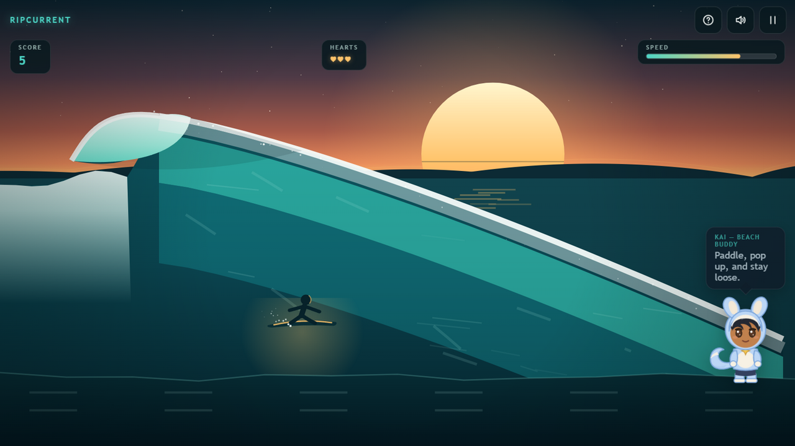

# RIPCURRENT

**Evening glass at the point, and the sets are firing.** A side-view surfing arcade — carve up the face, launch off the lip, survive the tube, and do it all before the sun goes down.

[▶ Play Ripcurrent](https://siddhant-pardeshi.github.io/ripcurrent-surf/) — free, no install, no login. Phones and desktops.



## The pitch

One breaking wave, rendered as a living thing: layered teal water, a foam crest, spray in the wind, a huge low sun behind the headland. You are the silhouette on the board. Gravity pulls you down the face; carving up costs speed, dropping in earns it. Launch off the lip for tricks — spins with point values and landings that punish greed — and when the wave curls forward, stay in the **tube** for double score and the run's loudest moment.

Three hearts. Sets get steeper and faster as the light fades. How long can you stay on the water?

## Board briefings: Git survival moves

Buoys drift in the swell carrying **Git commands**, and between sets Kai runs a **board briefing** — one concept card about the command you just carved past: what stash pop does that apply does not, why revert beats force-push on a shared branch, how reflog finds "lost" commits. Correct briefings pay +250, every card is tracked in the menu's **Concepts** codex, and the world pauses while you read.

## Controls

| Action | Keyboard | Touch |
| --- | --- | --- |
| Carve up / drop in | `↑` `↓` / `W` `S` | Joystick (vertical) |
| Launch / trick | `Space` | JUMP button |
| Pause | `Esc` / `P` | Pause icon |

- **Speed is life** — below the minimum the wave overtakes you and it's a wipeout.
- **Land flat.** A trick landing at a steep angle is a nose dive.
- **The tube** wants the middle band of the face, low and patient.
- Full guide: [docs/HOW_TO_PLAY.md](docs/HOW_TO_PLAY.md).

## Kai, your beach buddy

The character in the corner is Kai — towel-side commentary all session. They hype your tricks with real animations, call the tube, sympathize with wipeouts, and nap when you pause. Hide or mute them in Settings. Rig details: [docs/mascot-guide.md](docs/mascot-guide.md).

## Accessibility & settings

Volume sliders and mute (`M`), quality tiers, reduced motion, hideable mascot, fullscreen, keyboard-playable menus, touch targets ≥ 44px. Fully playable muted — the ocean shows you everything it says.

## Under the hood

One shared game kit, zero downloaded assets: the wave is a procedurally curled curve with layered water bands and foam particles; the surfer is drawn vector geometry with pose states; the soundtrack — an 84 BPM menu pad and a 96 BPM laid-back groove with off-grid hats — is synthesized live with WebAudio. Personal best lives in localStorage.

- [docs/HOW_TO_PLAY.md](docs/HOW_TO_PLAY.md)
- [docs/mascot-guide.md](docs/mascot-guide.md)
- [docs/QA.md](docs/QA.md)

## Run it locally

```bash
python -m http.server 8000
# open http://localhost:8000
```

## License

MIT — see [LICENSE](LICENSE). All code, art, characters and music are original work.

Inspired by surf-culture arcade classics. Not affiliated with or endorsed by any studio or publisher.
